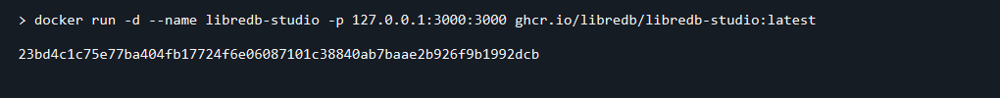
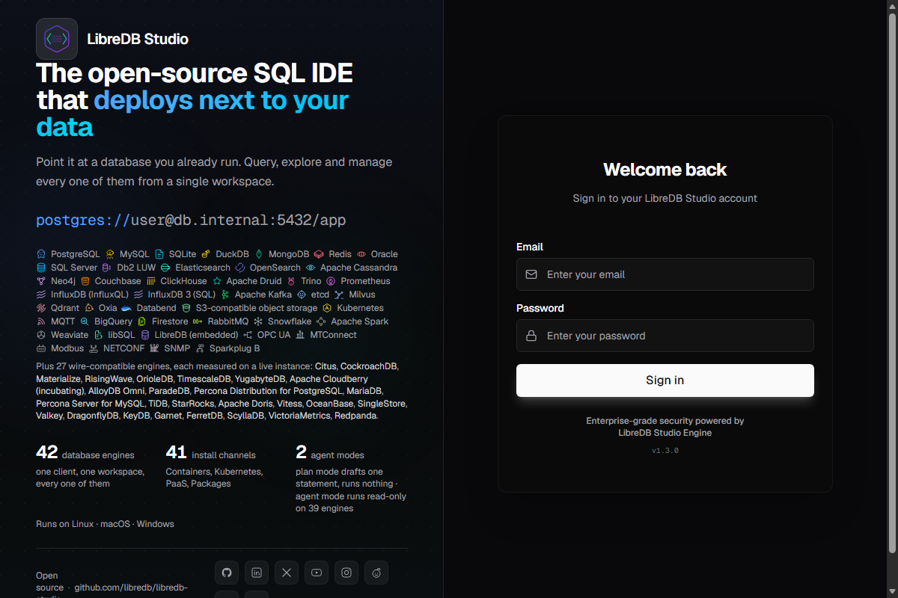
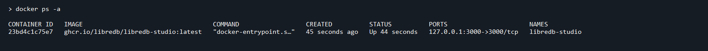
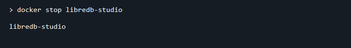
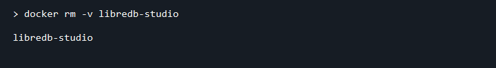
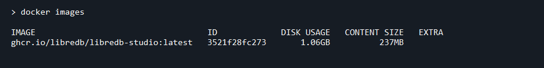
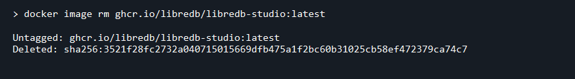
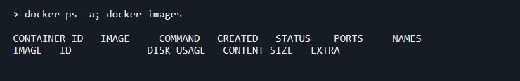

## LibreDB Studio

**LibreDB Studio** — это открытая (MIT-лицензия) веб-IDE для работы с базами данных, которая разворачивается как контейнер Docker рядом с самой базой, а не на машине разработчика. По сути, это «браузерный DataGrip/DBeaver» — единая точка входа для запросов, визуализации и администрирования

    Вместо того чтобы каждый разработчик устанавливал десктопное приложение и искал строки подключения, вы разворачиваете один контейнер на сервере (или в облаке) рядом с базой. Пользователи заходят через браузер — включая мобильные устройства, что актуально для «горящих» запросов

### 1. Создание и запуск LibreDB Studio в Windows

В PowerShell запускаем контейнер. Порт доступен локально на компьютере.

```powershell
docker run -d --name libredb-studio -p 127.0.0.1:3000:3000 ghcr.io/libredb/libredb-studio:latest
```


Открываем [LibreDB Studio](http://localhost:3000). Страница входа ответила HTTP 200.



### 2. Удаление проекта

Получаем имя контейнера.

```powershell
docker ps -a
```


Останавливаем контейнер.

```powershell
docker stop libredb-studio
```


Удаляем контейнер и его анонимные тома.

```powershell
docker rm -v libredb-studio
```


Получаем имя образа.

```powershell
docker images
```


Удаляем образ.

```powershell
docker image rm ghcr.io/libredb/libredb-studio:latest
```


Проверяем, что контейнер и образ удалены.

```powershell
docker ps -a; docker images
```


### Полезные ссылки

- [LibreDB Studio - анонс новой версии](https://www.opennet.ru/opennews/art.shtml?num=66216)

> Если вы обнаружили ошибку в этом тексте - сообщите пожалуйста автору!
