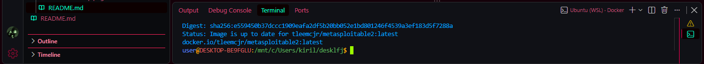
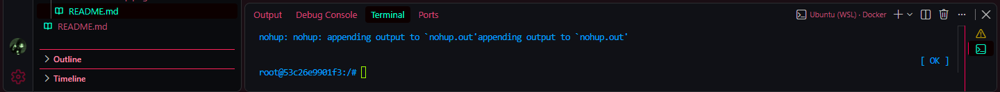

## Metasploitable2 docker

Выполните все этапы работы с проектом по примеру с [Nginx](/content/Docker/ImageLibrary/Nginx.md)

> Никогда в разработке не используйте русские имена файлов и каталогов!

> Никогда в разработке не используйте пробелы и спец.символы в именах файлов и каталогов!

> Создание проекта лучше начать с "чистого листа", предварительно остановив и удалив все другие контейнеры и образы!

```
Metasploitable2 — специально уязвимая виртуальная машина Linux, созданная проектом Metasploit. Предназначена для использования в качестве среды обучения и тестирования для специалистов и энтузиастов в области безопасности, чтобы практиковать навыки взлома и пентеста.
```

Установить докер-образ

```shell
docker pull tleemcjr/metasploitable2
```


Загрузить образ, создать и запустить контейнер, войти в него (для Windows)
```shell
docker run --network none --name metasploitable2 -it tleemcjr/metasploitable2
```


Остановить контейнер и выйти из него
```shell
exit
```

[Metasploitable2 на Docker hub](https://hub.docker.com/r/tleemcjr/metasploitable2#!)
