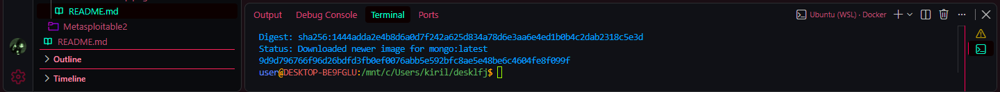
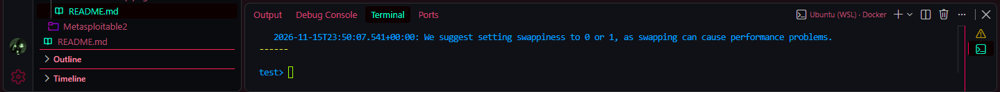
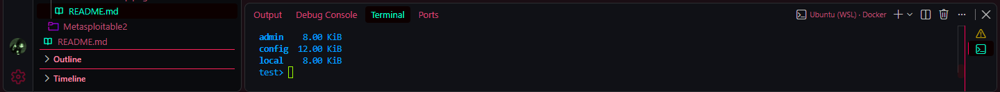
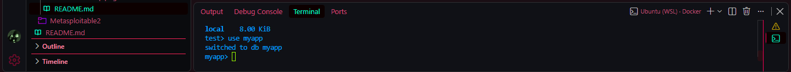
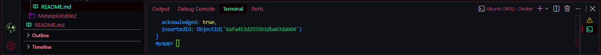
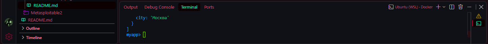
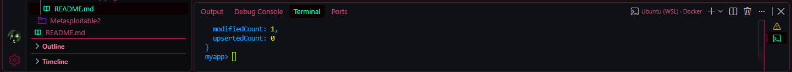

## MongoDB (NoSQL)

Выполните все этапы работы с проектом по примеру с [Nginx](/content/Docker/ImageLibrary/Nginx.md)

> Никогда в разработке не используйте русские имена файлов и каталогов!

> Никогда в разработке не используйте пробелы и спец.символы в именах файлов и каталогов!

> Создание проекта лучше начать с "чистого листа", предварительно остановив и удалив все другие контейнеры и образы!

1. Запуск **MongoDB**

в **Git-Bash/Linux/WSL 2.0/Mac**
```shell
docker run -d \
  --name my-mongo \
  -p 127.0.0.1:27017:27017 \
  mongo:latest
```


2. Подключиться через shell
```shell
docker exec -it my-mongo mongosh
```


Повыполняйте какие-нибудь команды в этой БД для проверки и пришлите скрины

Посмотреть базы данных
```shell
show dbs
```

Создать/переключиться на базу
```shell
use myapp
```

Создать коллекцию и вставить документ
```shell
db.users.insertOne({ name: "Иван", age: 30, city: "Москва" })
```

Найти документы
```shell
db.users.find()
```

Найти с фильтром
```shell
db.users.find({ age: { $gt: 25 } })
```

Обновить документ
```shell
db.users.updateOne({ name: "Иван" }, { $set: { age: 31 } })
```

Удалить документ
```shell
db.users.deleteOne({ name: "Иван" })
```
Посмотреть коллекции
```shell
show collections
```
Выйти
```shell
exit
```
