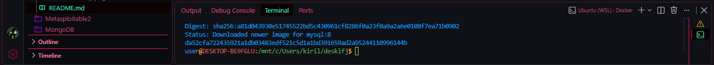
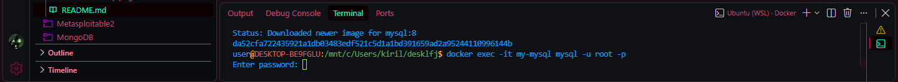
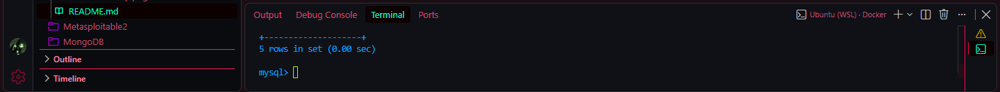
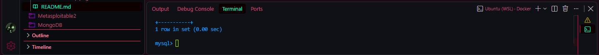

## MySQL база данных

Выполните все этапы работы с проектом по примеру с [Nginx](/content/Docker/ImageLibrary/Nginx.md)

> Никогда в разработке не используйте русские имена файлов и каталогов!

> Никогда в разработке не используйте пробелы и спец.символы в именах файлов и каталогов!

> Создание проекта лучше начать с "чистого листа", предварительно остановив и удалив все другие контейнеры и образы!

1. Запуск **MySQL**

в **Git-Bash/Linux/WSL 2.0/Mac**
```shell
docker run -d \
  --name my-mysql \
  -p 127.0.0.1:3306:3306 \
  -e MYSQL_ROOT_PASSWORD=rootpassword \
  -e MYSQL_DATABASE=mydb \
  -e MYSQL_USER=user \
  -e MYSQL_PASSWORD=password \
  mysql:8
```


2. Подключиться
```shell
docker exec -it my-mysql mysql -u root -p
```

> Пароль: rootpassword

Повыполняйте какие-нибудь команды SQL для проверки и пришлите скрины.

Получить список баз данных:
```sql
SHOW DATABASES;
```

Получить версию:
```sql
SELECT version();
```

выйти из БД
```sql
exit
```
