## Практическая работа на примере готового образа Nginx в Docker

> **Nginx** - это легкий и небольшой веб-сервер

> Никогда в разработке не используйте русские имена файлов и каталогов!

> Никогда в разработке не используйте пробелы и спец.символы в именах файлов и каталогов!

> Создание проекта лучше начать с "чистого листа", предварительно остановив и удалив все другие контейнеры и образы!

## Этапы

Получить версию установленного у вас Docker

```shell
docker version
```
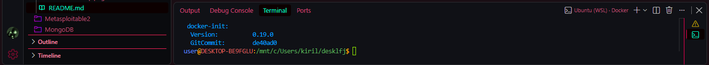

Найти нужный образ на **Docker Hub**

```shell
docker search nginx
```
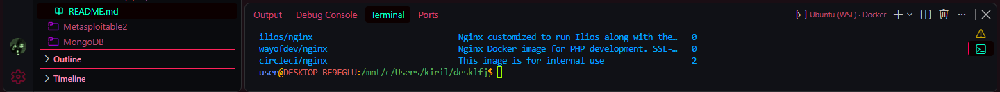

Получить, создать и запустить Nginx

```shell
docker run -d --name my-nginx -p 127.0.0.1:80:80 nginx
```
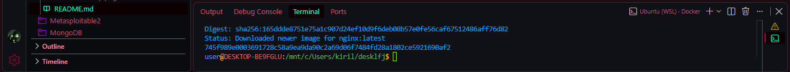

Показать все контейнеры

```shell
docker ps -a
```
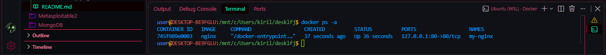

Показать загруженный на ваш компьютер образ

```shell
docker images nginx
```
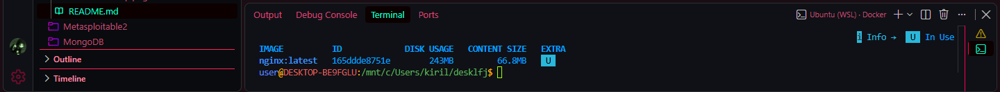

Показать работающий Nginx

```shell
curl http://localhost/
```
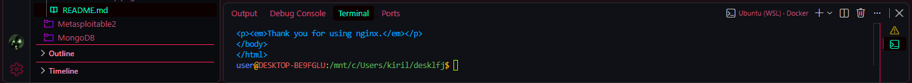

[Открыть http://localhost/ в браузере](http://localhost/)

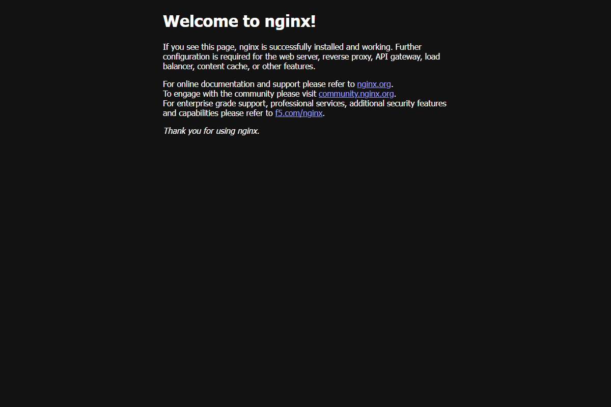

Показать подробности о контейнере

```shell
docker inspect --format "{{.State.Status}} {{.Config.Image}}" my-nginx
```
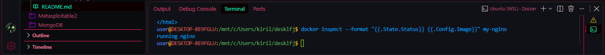

Запустить мониторинг контейнеров

```shell
docker stats --no-stream my-nginx
```
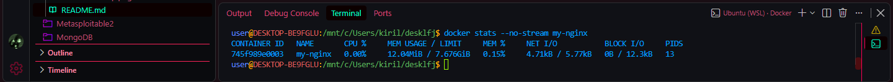

Получить лог контейнера

```shell
docker logs --tail 3 my-nginx
```
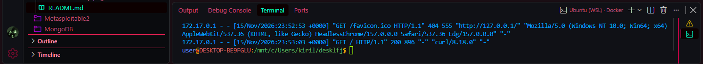

Остановить контейнер

```shell
docker stop my-nginx
```
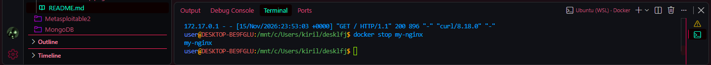

Снова запустить контейнер

```shell
docker start my-nginx
```
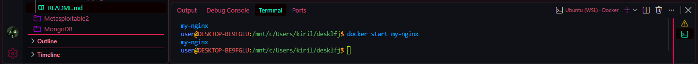

Перезапустить контейнер

```shell
docker restart my-nginx
```


Зайти в контейнер

```shell
docker exec -it my-nginx /bin/bash
```
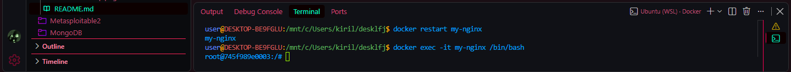

Получить информацию об ОС контейнера

```shell
uname -a
```
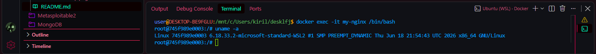

Получить больше информации об ОС контейнера

```shell
cat /etc/os-release
```
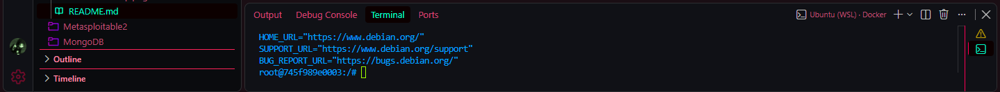

Выйти из контейнера

```shell
exit
```

Отредактировать текст страницы приветствия **Nginx**

```shell
docker cp /tmp/imfua-nginx-index.html my-nginx:/usr/share/nginx/html/index.html
```
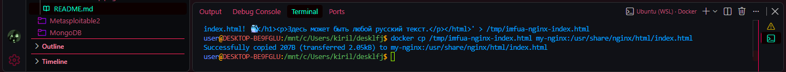

[Проверить изменения на открытой странице](http://localhost/)

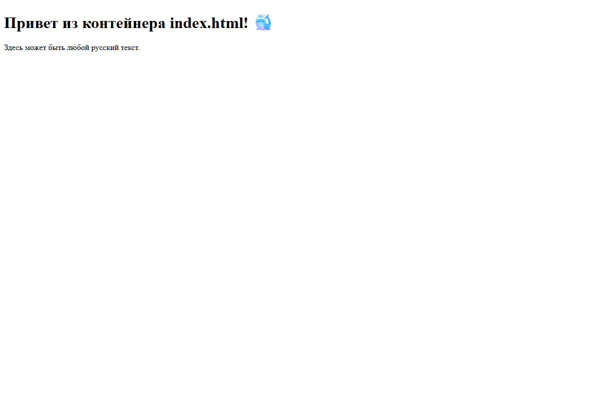
