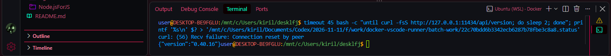
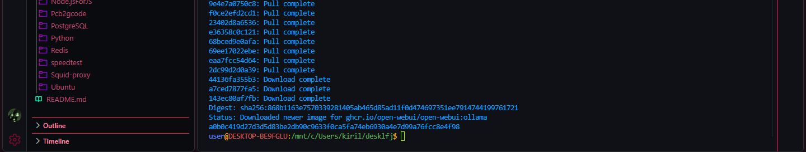
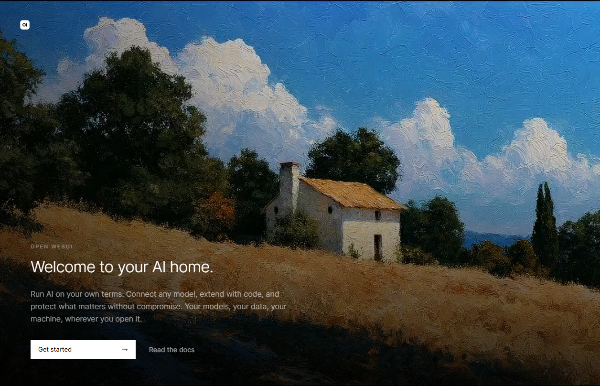
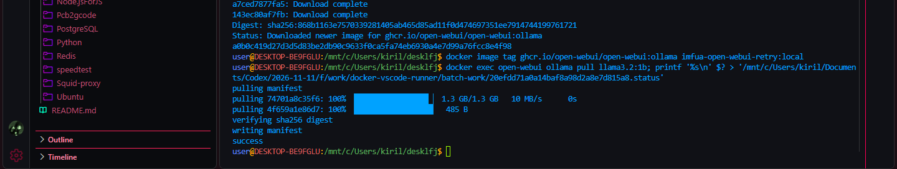
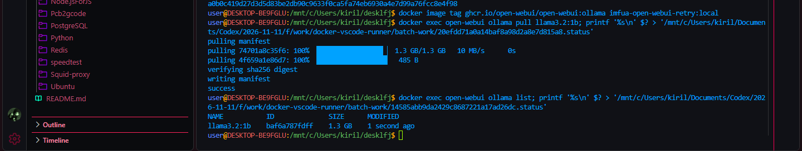

## Запуск Ollama в контейнере

### 1. Ollama+phi4

Получить ollama:
```shell
docker run -d -v imfua-phi4-lab:/root/.ollama -p 127.0.0.1:11434:11434 --name ollama ollama/ollama
```

```shell
docker exec -it ollama ollama run phi4
```
выйти из командного режима нейросети:
```shell
/exit
```
и
```shell
/bye
```

---

### 2. Open WebUI и Ollama

```shell
docker run -d -p 127.0.0.1:8081:8080 \
  -v imfua-webui-ollama-lab:/root/.ollama \
  -v imfua-webui-lab:/app/backend/data \
  --name open-webui \
  --restart always \
  ghcr.io/open-webui/open-webui:ollama
```

[Открыть чат в браузере](http://localhost:8081)


Загрузить модель, например `llama3.2:1b`
```shell
docker exec -it open-webui ollama pull llama3.2:1b
```

показать установленные модели:
```shell
docker exec -it open-webui ollama list
```

