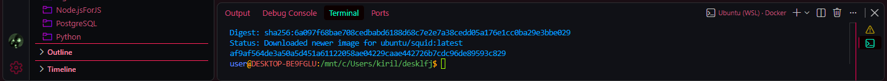
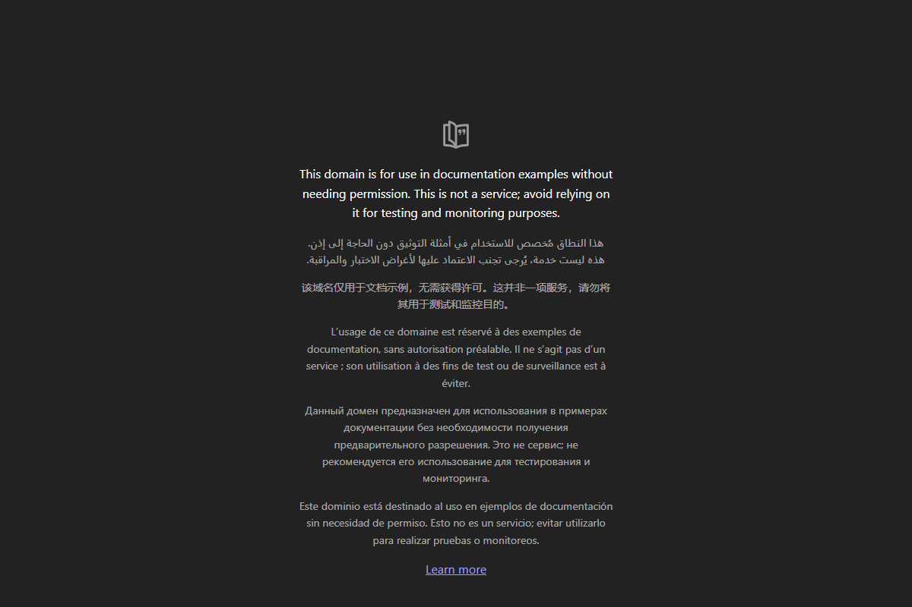

## Прокси сервер Squid proxy

> Никогда в разработке не используйте русские имена файлов и каталогов!

> Никогда в разработке не используйте пробелы и спец.символы в именах файлов и каталогов!

> Создание проекта лучше начать с "чистого листа", предварительно остановив и удалив все другие контейнеры и образы!

1. Запустить **Squid proxy**

в **Git-Bash/Linux/WSL 2.0/Mac**
```shell
docker run -d \
  --name squid-proxy \
  -p 127.0.0.1:3128:3128 \
  ubuntu/squid:latest
```

2. [Настройте браузер использовать proxy: localhost:3128](localhost:3128)

