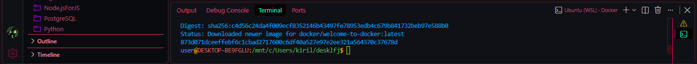
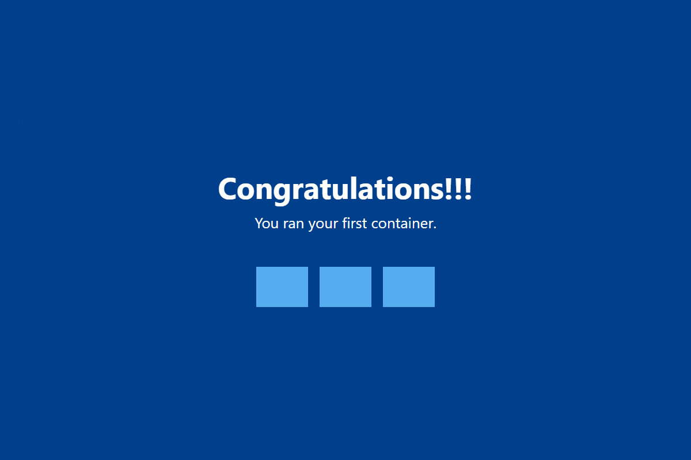
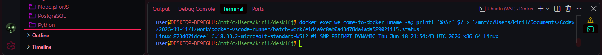
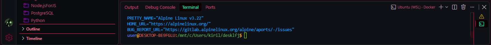
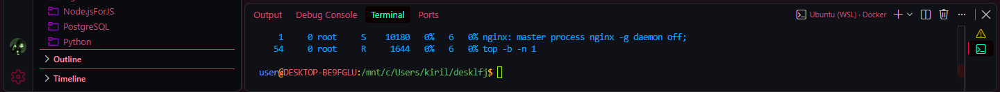
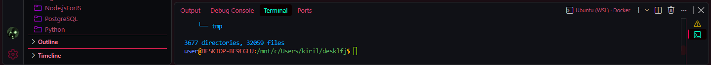
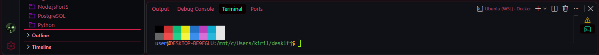

## Welcome to Docker

> Никогда в разработке не используйте русские имена файлов и каталогов!

> Никогда в разработке не используйте пробелы и спецсимволы в именах файлов и каталогов!

> Создание проекта лучше начать с "чистого листа", предварительно остановив и удалив все другие контейнеры и образы!

Это репозиторий для новых пользователей, начинающих работу с **Docker**

Для выполнения задания создайте в репозитории отдельную папку `Docker`, в ней папку `img` и папку `WelcomeToDocker` и в ней файл `README.md`.

Выполните все этапы работы с проектом по примеру с [Nginx](/content/Docker/ImageLibrary/Nginx.md)

> Перед созданием проекта убедитесь, что порт `8088` не занят другим приложением!

Проверить порт `8088` для **Linux/Mac/WSL**:
```shell
# Проверьте, занят ли порт
netstat -tuln | grep :8088
```
> Если эта команда ничего не возвращает, то порт свободен

Загрузить образ и запустить контейнера
```shell
docker run -d -p 127.0.0.1:8088:80 --name welcome-to-docker docker/welcome-to-docker
```


[Открыть http://localhost:8088 в браузере](http://localhost:8088)



Зайти в контейнер
```shell
docker exec -it welcome-to-docker /bin/sh
```

Повыполнять разные команды:

Показать ин-фу по ОС
```shell
uname -a
```

```shell
cat /etc/os-release
```

Диспетчер ресурсов
```shell
top -b -n 1
```

```shell
tree
```

Обновить источники приложений
```shell
apk update && apk upgrade
```
Установить приложение
```shell
apk add fastfetch
```
Запустить приложение
```shell
fastfetch
```

Выйти из контейнера
```shell
exit
```

Результаты работы с проектом прислать в виде ссылки на `README.md` с оформленным в **Markdowd** текстом с скриншотами по примеру с **Nginx**
